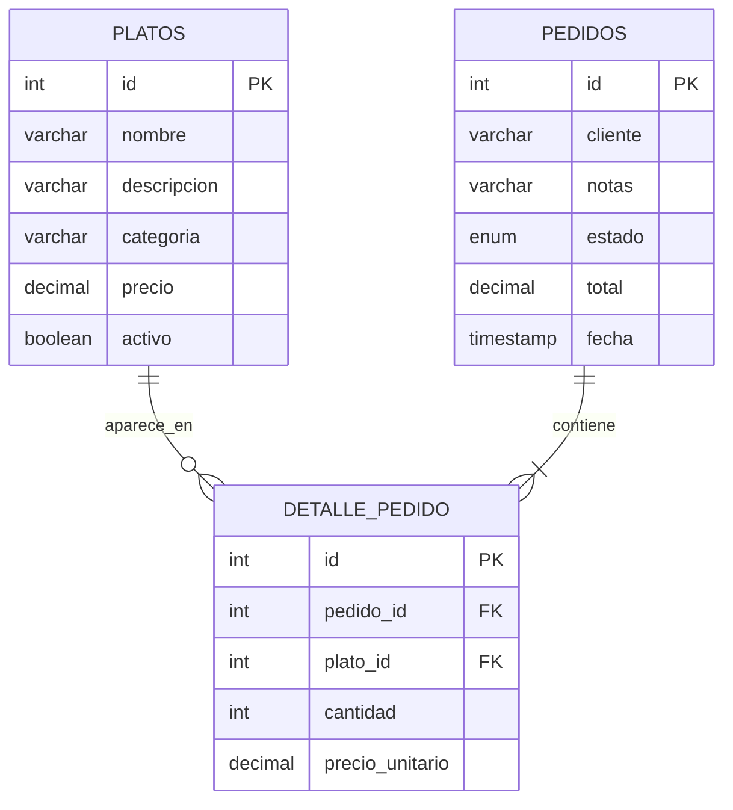

# Análisis y diseño inicial

## Planteamiento del problema

Un negocio de comida necesita presentar su menú de forma clara y preparar la base de un sistema que posteriormente permita recibir pedidos. El manejo informal del menú dificulta consultar precios y disponibilidad, mientras que registrar pedidos sin una estructura de datos puede producir totales incorrectos o perder el detalle de lo solicitado.

## Objetivo general

Diseñar la base de un sistema web de pedidos de comida que organice el catálogo, los pedidos y sus detalles, y presentar un prototipo adaptable del menú.

## Requisitos de la Fase 1

### Funcionales

1. Mostrar los platos disponibles con nombre, descripción, categoría y precio.
2. Buscar platos por nombre o descripción.
3. Filtrar el catálogo por categoría.
4. Permitir combinar la búsqueda con el filtro de categoría.
5. Informar cuando no existan resultados.
6. Crear la estructura de datos para platos, pedidos y detalles de pedido.
7. Proporcionar datos iniciales que permitan demostrar el catálogo.

### No funcionales

- La interfaz debe adaptarse a computadoras y teléfonos.
- El HTML debe usar elementos semánticos y controles accesibles mediante teclado.
- La base de datos debe usar claves primarias, claves foráneas y restricciones de integridad.
- Los textos deben almacenarse con codificación `utf8mb4`.

## Alcance

La Fase 1 entrega el diseño de datos y un prototipo estático del catálogo. La conexión con MySQL, la API REST, el carrito y la creación de pedidos se implementarán en las siguientes fases.

## Diseño de la base de datos



`detalle_pedido` resuelve la relación de muchos a muchos entre pedidos y platos. El precio unitario queda guardado en el detalle para conservar el valor cobrado aunque el precio del catálogo cambie después.

## Boceto de navegación

```text
+------------------------------------------------------+
| LA MESA                              Catálogo         |
+------------------------------------------------------+
| ¿Qué se te antoja hoy?                                |
| [ Buscar un plato...       ] [ Todas las categorías ] |
|                                                       |
| [ Plato ]  [ Plato ]  [ Plato ]                       |
| [ Plato ]  [ Plato ]  [ Plato ]                       |
+------------------------------------------------------+
```
